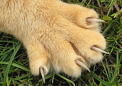

# Anatomie

Die Anatomie der Hauskatze ist auf **Jagd, Klettern und Balance** spezialisiert. Von den einziehbaren Krallen über die flexible Wirbelsäule bis zu den hochsensiblen Schnurrhaaren — jedes Merkmal erfüllt eine spezifische Funktion im Alltag eines Raubtiers.

Die Pfote im Bild zeigt die Krallen in ausgefahrenem Zustand. Normalerweise ruhen sie in Ledertaschen (*Reigments*) verborgen und werden nur bei Bedarf ausgefahren: beim Klettern, bei der Jagd oder in Verteidigungssituationen. Die Ballen (*Toe Pads*) darunter dienen als Stoßdämpfer und tragen Duftdrüsen zur Reviermarkierung.

Katzen besitzen 18 Zehen insgesamt — fünf an jeder Vorderpfote (inklusive Daumenzehe) und vier an jeder Hinterpfote. Die vordere Daumenzehe (*dewclaw*) ist nicht mit dem Boden in Kontakt und hilft beim Festhalten von Beute.

## Vergleich: Krallen, Zähne, Schnurrhaare

| Feature  | Function                      | Retractable | Sensitivity                    |
|----------|-------------------------------|-------------|--------------------------------|
| Claws    | Climbing, hunting, defense    | yes         | medium (touch via paw pads)    |
| Teeth    | Gripping prey, grooming       | no          | low                            |
| Whiskers | Spatial awareness, navigation | no          | very high (follicle receptors) |

## Unterseiten

- [Claws](Test/Anatomy/Claws.md) — Aufbau und Pflege der Krallen
- [Yawning](Test/Anatomy/Yawning.md) — Gähnverhalten und Kieferanatomie
- [Gallery](Test/Subpage/Gallery.md) — Weitere Anatomie-Fotos