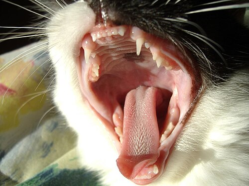

# Gähnen

Gähnen bei Katzen ist ein vielseitiges Verhalten — es signalisiert nicht immer Müdigkeit, sondern kann auch Stress, Langeweile oder soziale Kommunikation ausdrücken.

## Makroaufnahme

## Gähn-Phasen

| Stage     | Duration | Meaning                                        |
|-----------|----------|------------------------------------------------|
| Pre-yawn  | 1–2 s    | Augen schließen sich, Ohren drehen leicht      |
| Full yawn | 3–5 s    | Maul weit geöffnet, Zunge gestreckt            |
| Post-yawn | 2–4 s    | Pfoten strecken, Schwanz richtet sich auf      |
| Recovery  | variabel | Normaler Blick, eventuell Schütteln des Kopfes |

## Scheunenfenster-Gähnen

Diese Aufnahme aus Großarl zeigt das typische **Gähn-Dehn-Muster**: erst das weite Öffnen des Mauls, dann das Strecken der Vorderpfoten. Der Kontext — ein sonniges Fensterbrett — deutet auf Entspannung hin.