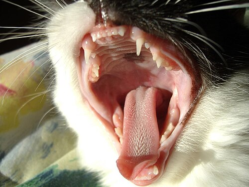

Dieses Collective dient als **Test** für Markdown-Rendering, HTML-Einbettungen, Tabellen, Querverweise und Collectives-spezifische Syntax. Die Inhalte sind bewusst vielfältig — von einfachen Absätzen bis zu schwebenden Bildern und syntaxhervorgehobenem Code.

## Über Hauskatzen

Die Hauskatze (*Felis catus*) ist eines der beliebtesten Haustiere weltweit. Ihre Anatomie — von einziehbaren Krallen über filigrane Schnurrhaare bis zu charakteristischen Fellmustern — macht sie zu faszinierenden Studienobjekten für Dokumentation und Layout-Tests gleichermaßen.

Das ist ein weiterer Satz.

Blauäugige Katzen verdanken ihre Augenfarbe einer **Tyrosinase-Mutation**, die die Pigmentierung der Iris reduziert. Dies tritt häufig bei weißem oder teilweise weißem Fell auf und ist besonders auffällig bei Tabby-Mustern, wie auf dem Foto oben.