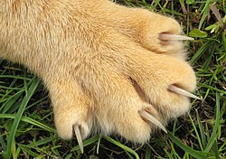

# Krallen

Die Krallen (*claws*) der Hauskatze sind aus Keratin aufgebaut — demselben Material wie menschliche Fingernägel — und wachsen kontinuierlich nach.

## Aufbau

1. **Krallenbein** (*ungual bone*) — verankert die Klaue in der Pfote
2. **Ledertasche** (*sheath*) — schützt die Klaue im Ruhezustand
3. **Sehnen-Mechanismus** — zieht die Klaue ein oder fährt sie aus
   - Digitale Flexor-Sehnen
   - Elastic ligaments für Schnellbewegung
   - Passive Retraction im Normalfall

## Pflege-Tipps

- Kratzbäume fördern natürliches Abnutzen
- Nur die **Spitze** trimmen, nie die rosa Quick-Zone
- Bei Verfärbung oder Rissen zum Tierarzt

## Siehe auch

- [Cats](../Readme.md) — Übersicht
- [Anatomy](../Anatomy/Readme.md) — Pfoten-Nahaufnahme