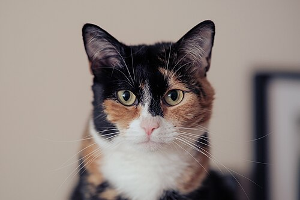

# Galerie

Diese Seite zeigt alle sechs Wikimedia-Bilder in verschiedenen Markdown- und HTML-Formaten.

## Dreifarbige Katze (Calico)

Die **Calico-Färbung** (auch Tortoiseshell-and-White genannt) entsteht durch eine Kombination aus Orange- und Schwarz-Genen auf der X-Chromosom. Da Männchen in der Regel nur ein X-Chromosom besitzen, sind fast alle Calico-Katzen weiblich — ein klassisches Beispiel für X-Chromosom-Inaktivierung (Lyonisierung).

Das auffällige Muster aus schwarzen, orangefarbenen und weißen Flecken macht jede Calico-Katze einzigartig. Die weißen Bereiche entstehen durch das *White-Spotting*-Gen, das die Ausbreitung der Pigmentzellen während der Embryonalentwicklung beeinflusst.

Die grün-gelben Augen, wie auf dem Foto zu sehen, sind typisch für diese Fellzeichnung und verleihen dem Tier einen wachen, aufmerksamen Ausdruck.

## Tabby im Garten

**Filou** — so der Name dieser getigerten Hauskatze — zeigt die klassische Tabby-Haltung: aufrecht sitzend, Ohren nach vorn gerichtet, der Blick folgt etwas außerhalb des Bildrahmens. Diese Körpersprache signalisiert Neugier und leichte Wachsamkeit, nicht Aggression.

Tabby-Muster sind keine Rasse, sondern ein Fellmuster, das bei vielen Rassen vorkommt. Die charakteristische „M"-Form auf der Stirn und die dunklen Streifen am Rücken entstehen durch die Agouti-Gen-Variante, die jedes einzelne Haar in mehrere Farbbänder unterteilt.

Im Freien nutzen Katzen solche erhöhten Positionen — hier der Rand einer Steinplatte — als Aussichtspunkt, um Beute oder Artgenossen zu beobachten.

## Gähnen am Scheunenfenster

Katzen gähnen nicht nur aus Müdigkeit — ein ausgiebiges Gähnen kann auch **Stressabbau**, Übergang in den Schlaf oder soziale Signale an Artgenossen bedeuten. Die gezeigte Katze liegt entspannt auf dem Fensterbrett einer alten Scheune in Großarl, Österreich.

Das weit geöffnete Maul enthüllt Zunge, Zahnreihe und Gaumen — Details, die auch auf der Seite [Yawning](Test/Anatomy/Yawning.md) weiter vertieft werden. Die verwitterte Holzstruktur des Fensterrahmens bildet einen natürlichen Rahmen und kontrastiert schön mit dem weichen Fell.

Nach dem Gähnen strecken Katzen häufig alle vier Pfoten aus — ein Verhalten, das als „Gähn-Dehn-Komplex" bekannt ist und den Kreislauf ankurbelt.

## Weitere Aufnahmen

### Pfote mit Krallen

### Makro-Gähnen

### Blauäugige Katze

## 